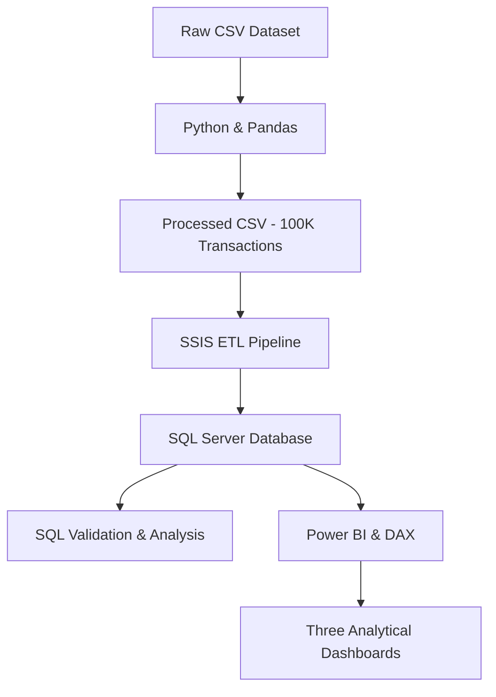
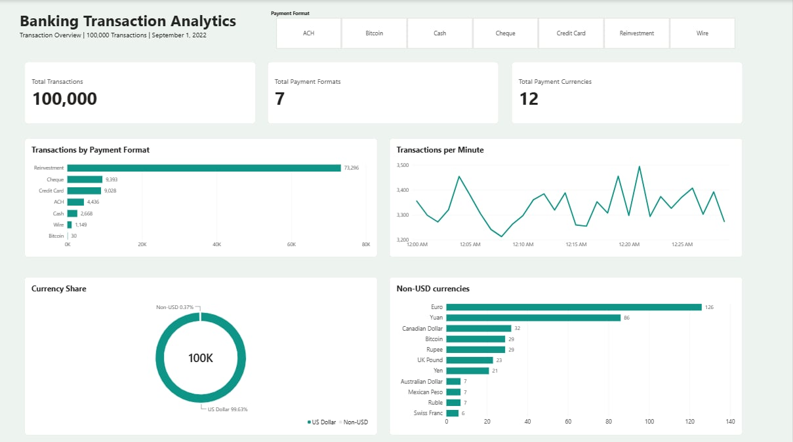
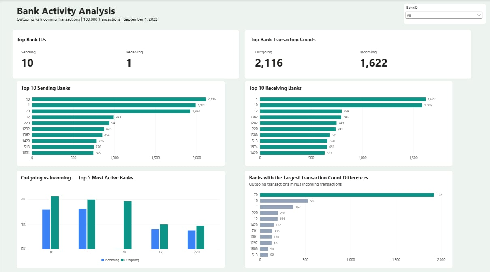
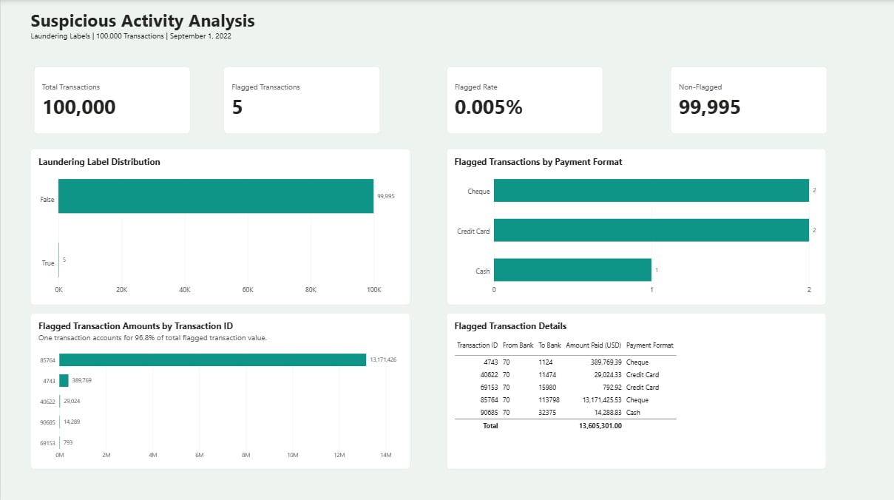

# Banking Transaction Analytics

### End-to-End Data Analytics Portfolio Project

## Project Overview

This project analyzes 100,000 synthetic financial transactions using Python, SQL Server, SQL Server Integration Services (SSIS), and Power BI.

The objective is to explore transaction patterns, analyze sending and receiving bank activity, and investigate transactions labeled as money laundering within the dataset.

The project follows an end-to-end data analytics workflow, from data exploration and preparation to ETL development, SQL-based validation, and interactive dashboard creation.

Three Power BI report pages were developed:

1. **Transaction Overview** — Analyzes transaction volumes, payment formats, currencies, and transaction activity over time.
2. **Bank Activity Analysis** — Compares sending and receiving bank activity and identifies transaction-count differences.
3. **Suspicious Activity Analysis** — Examines labeled transactions, their payment formats, transaction amounts, and bank information.

The project demonstrates data preparation, data quality validation, ETL implementation, SQL analysis, DAX calculations, and data visualization.

## Business Objectives

This project aims to explore financial transaction patterns and provide insights into banking activity through three analytical areas.

### 1. Transaction Overview
- Which payment formats are used most frequently?
- How are transactions distributed across payment currencies?
- How does transaction volume change over the observed time period?

### 2. Bank Activity Analysis
- Which banks have the highest outgoing and incoming transaction counts?
- How do outgoing and incoming transaction volumes compare across banks?
- Which banks show the largest differences between outgoing and incoming transaction counts?

### 3. Suspicious Activity Analysis
- How many transactions are labeled as money laundering?
- What percentage of transactions are flagged?
- Which payment formats and banks appear in the flagged transactions?
- How are transaction amounts distributed among flagged transactions?

## Dataset Description

**Source:** IBM Synthetic Financial Transactions Dataset

The project uses a sample of 100,000 synthetic financial transactions prepared from the original dataset.

### Dataset Summary

| Attribute | Description |
|---|---|
| Dataset Type | Synthetic financial transactions |
| Records Analyzed | 100,000 |
| Time Period | September 1, 2022, 00:00–00:29 |
| Payment Formats | 7 |
| Payment Currencies | 12 |
| Flagged Transactions | 5 |
| Flagged Rate | 0.005% |

### Key Variables

| Column | Description |
|---|---|
| TransactionTimestamp | Date and time of the transaction |
| FromBank | Identifier of the sending bank |
| FromAccount | Identifier of the sending account |
| ToBank | Identifier of the receiving bank |
| ToAccount | Identifier of the receiving account |
| AmountPaid | Transaction amount in the payment currency |
| PaymentCurrency | Currency used for payment |
| AmountReceived | Amount received by the destination account |
| ReceivingCurrency | Currency received |
| PaymentFormat | Payment method or transaction format |
| IsLaundering | Boolean label indicating whether a transaction is flagged as laundering |

### Data Scope

The analysis focuses on the first 100,000 records selected for this project, covering a 30-minute period.

Because the dataset is synthetic and the sample covers a limited time window, the findings should not be generalized to real-world banking activity.

Additionally, only five transactions are labeled as laundering, creating significant class imbalance.

## Tools & Technologies

The project integrates several technologies to support an end-to-end data analytics workflow, from data preparation to reporting.

| Technology | Purpose |
|---|---|
| Python | Data exploration, preprocessing, and validation |
| Pandas | Data manipulation, quality checks, and exploratory analysis |
| Jupyter Notebook | Documenting data exploration and analytical findings |
| SQL Server | Relational database storage and data analysis |
| SQL | Database creation, data validation, reconciliation, and business analysis |
| SQL Server Integration Services (SSIS) | ETL development and loading transaction data into SQL Server |
| Power BI | Interactive dashboard development and data visualization |
| DAX | Calculated measures, bank activity analysis, and KPI development |
| Git & GitHub | Version control, project documentation, and portfolio publishing |

## Project Workflow & Architecture

The project follows an end-to-end analytics workflow consisting of five main stages.

### 1. Data Exploration

Python and Pandas were used to explore the financial transaction dataset, examine its structure, identify missing values, and investigate transaction patterns.

The analysis was documented in Jupyter Notebooks.

### 2. Data Preparation

A Python preprocessing script was used to extract and prepare a sample of 100,000 transactions from the original dataset.

The prepared data was exported to CSV for database loading.

### 3. ETL Development

SQL Server Integration Services (SSIS) was used to implement the ETL workflow.

The pipeline loads the prepared transaction data into SQL Server, where appropriate data types and column mappings are applied.

### 4. SQL Validation & Analysis

SQL queries were developed to validate imported records, reconcile transaction amounts, investigate data quality issues, and analyze banking activity.

Special attention was given to preserving decimal precision for cryptocurrency transactions.

### 5. Power BI Reporting

Power BI was connected to the SQL Server database to develop three analytical report pages.

DAX measures and calculated tables were used to create KPIs, analyze bank activity, and examine transactions labeled as laundering.



## Data Quality & ETL Validation

Data quality checks were performed during the Python exploration and SQL Server validation stages to ensure the accuracy and consistency of the imported transactions.

### Data Validation

The following checks were performed on the 100,000-record dataset:

| Validation Check | Result |
|---|---|
| Total imported records | 100,000 |
| Missing values in critical fields | 0 |
| Negative AmountPaid values | 0 |
| Negative AmountReceived values | 0 |
| Zero AmountPaid values | 0 |
| Zero AmountReceived values | 0 |
| Transaction date range | 2022-09-01 00:00–00:29 |
| Transactions labeled as laundering | 5 |

### Technical Challenge: Decimal Precision in Bitcoin Transactions

During the SSIS data loading process, an issue was identified with the decimal precision of cryptocurrency transaction amounts.

Initially, the SQL Server columns `AmountPaid` and `AmountReceived` were defined as `DECIMAL(20,2)`.

This caused small Bitcoin transaction amounts, such as `0.003327`, to be stored as `0.00`, resulting in a loss of financial precision.

**Solution:**

1. Updated the SQL Server amount columns to `DECIMAL(28,8)`.
2. Adjusted the corresponding SSIS data conversion settings.
3. Reloaded the 100,000 transactions.
4. Executed SQL validation queries to verify the corrected values.

**Validation Result:**

After the correction, the original Bitcoin amount of `0.003327` was preserved as `0.00332700`.

The final validation confirmed that no zero or negative transaction amounts remained in the imported dataset.

### Key Takeaway

This issue highlighted the importance of selecting appropriate numeric data types when working with financial data, particularly when transaction amounts require more than two decimal places.

## Exploratory Data Analysis & Key Findings

The analysis identified several patterns in transaction volume, bank activity, and transactions labeled as money laundering.

### 1. Transaction Volume & Payment Formats

- **Reinvestment** was the most frequently used payment format, accounting for **73,296 transactions (73.30%)**.
- Cheque and Credit Card followed with 9,393 and 9,028 transactions, respectively.
- Transaction activity remained relatively consistent throughout the observed 30-minute period.

**Insight:** Reinvestment dominates transaction count within the analyzed sample. However, the limited observation window does not establish whether this pattern persists over longer periods.

### 2. Currency Distribution

- **US Dollar** was the dominant payment currency, appearing in **99,627 transactions (99.63%)**.
- Only 373 transactions (0.37%) used other payment currencies.
- Euro and Yuan were the most frequently observed non-USD payment currencies.

**Insight:** The analyzed sample is heavily concentrated in USD-denominated transactions.

### 3. Bank Activity

- **Bank 10** had the highest outgoing transaction count, with **2,116 transactions**.
- **Bank 1** had the highest incoming transaction count, with **1,622 transactions**.
- **Bank 70** recorded 1,924 outgoing transactions but only 3 incoming transactions, resulting in a transaction-count difference of **+1,921**.

**Insight:** Bank 70 exhibited the largest outgoing-minus-incoming transaction-count difference in the sample. This measures transaction frequency, not net monetary flow.

### 4. Flagged Transaction Analysis

- **5 out of 100,000 transactions (0.005%)** were labeled as money laundering.
- All five flagged transactions originated from **Bank 70**.
- The flagged transactions consisted of 2 Cheque, 2 Credit Card, and 1 Cash transaction.
- The combined Amount Paid for flagged transactions was **USD 13,605,301.00**.
- Transaction ID **85764**, valued at approximately USD 13.17 million, accounted for **96.8%** of the total flagged transaction value.

**Insight:** The flagged transactions were highly concentrated in both originating bank and transaction value. Due to the extremely small number of flagged records and the synthetic nature of the dataset, these patterns should not be interpreted as evidence of real-world money laundering or bank-level risk.

## Power BI Dashboard Showcase

Three interactive Power BI report pages were developed to present transaction patterns, bank activity, and flagged transaction characteristics.

### Dashboard 1 — Transaction Overview



This dashboard provides an overview of transaction volumes, payment format distribution, currency usage, and transaction activity over time.

### Dashboard 2 — Bank Activity Analysis



This dashboard compares outgoing and incoming transaction activity across banks and highlights differences in transaction counts.

### Dashboard 3 — Suspicious Activity Analysis



This dashboard examines transactions labeled as money laundering, including flagged rates, payment formats, transaction amounts, and record-level details.

## Project Structure

```text
banking-transaction-analytics/
│
├── data/
│   ├── raw/
│   └── processed/
│
├── notebooks/
│   ├── 01_data_understanding.ipynb
│   └── 02_exploratory_analysis.ipynb
│
├── scripts/
│   └── 03_prepare_sql_data.py
│
├── sql/
│   ├── 01_database_setup.sql
│   ├── 02_post_import_validation.sql
│   ├── 03_fix_amount_precision.sql
│   ├── 04_record_level_reconciliation.sql
│   └── 05_business_analysis.sql
│
├── ssis/
│   └── BankingAnalytics_ETL/
│       ├── 01_Load_Banking_Transactions.dtsx
│       ├── 02_Load_Transactions_Staging.dtsx
│       ├── BankingAnalytics_ETL.dtproj
│       ├── BankingAnalytics_ETL.slnx
│       └── Project.params
│
├── powerbi/
│   └── Banking_Transaction_Analytics.pbix
│
├── screenshots/
│   ├── transaction_overview.jpg
│   ├── bank_activity.jpg
│   └── suspicious_activity.jpg
│
├── .gitignore
└── README.md
```

**Note:** Raw and processed CSV datasets are excluded from version control through `.gitignore`. The original dataset must be obtained separately.

## Reproducibility & Setup Instructions

This section outlines the general process for reproducing the Banking Transaction Analytics project.

### Prerequisites

The following tools are required:

- Python 3 with Pandas and Jupyter Notebook
- Microsoft SQL Server
- SQL Server Management Studio (SSMS)
- Visual Studio with SQL Server Integration Services (SSIS)
- Power BI Desktop

### 1. Obtain the Dataset

Download the IBM Synthetic Financial Transactions dataset from its original source.

Place the source CSV file in:

`data/raw/HI-Small_Trans.csv`

The raw dataset is not included in this repository because of its file size.

### 2. Prepare the Data

Run the Python preprocessing script:

```bash
python scripts/03_prepare_sql_data.py
```

The script prepares the transaction sample used for the analysis.

The processed dataset is expected at:

`data/processed/banking_transactions_100k.csv`

### 3. Set Up SQL Server

Create the required database and tables using:

`sql/01_database_setup.sql`

Review the table definitions and ensure that monetary values use sufficient decimal precision.

### 4. Execute the SSIS ETL Pipeline

Open the SSIS project located in:

`ssis/BankingAnalytics_ETL/`

Configure the local SQL Server connection and CSV source path.

Execute the relevant SSIS packages to load the prepared transaction data into SQL Server.

### 5. Validate Imported Data

Use the SQL scripts to validate the imported records and investigate data quality:

- `02_post_import_validation.sql`
- `03_fix_amount_precision.sql`
- `04_record_level_reconciliation.sql`
- `05_business_analysis.sql`

The decimal precision correction script documents the issue encountered during development. Review its purpose before executing it against an existing database.

### 6. Open the Power BI Report

Open:

`powerbi/Banking_Transaction_Analytics.pbix`

If necessary, update the SQL Server connection through Power BI's Data source settings.

Refresh the data and review the three report pages:

1. Transaction Overview
2. Bank Activity Analysis
3. Suspicious Activity Analysis

### Reproducibility Notes

- The raw and processed CSV files are excluded from Git version control.
- Database connection settings must be configured for the local environment.
- SQL Server and SSIS versions may affect package compatibility.
- The project uses synthetic financial data and is intended for educational and portfolio purposes.

## Limitations & Future Improvements

### Limitations

Although this project provides insights into transaction patterns and bank activity, several limitations should be considered:

1. **Limited Observation Period:** The analysis covers only 100,000 transactions within a 30-minute period on September 1, 2022. The findings may not represent longer-term transaction patterns.

2. **Synthetic Dataset:** The dataset contains simulated financial transactions rather than actual banking records. Therefore, the findings should not be generalized to real-world financial institutions.

3. **Class Imbalance:** Only 5 out of 100,000 transactions (0.005%) are labeled as money laundering. This extremely small flagged sample limits the reliability of comparisons across banks and payment formats.

4. **Currency Differences:** Transactions involve multiple currencies. Monetary amounts should not be aggregated across different currencies without appropriate currency conversion.

5. **Descriptive Analysis:** The project focuses on exploratory and descriptive analytics. It does not implement a predictive fraud detection model or independently verify whether flagged transactions represent actual financial crimes.

### Future Improvements

Potential extensions of this project include:

1. **Expand the Dataset:** Analyze a larger sample covering a longer time period to identify more representative transaction patterns.

2. **Advanced SQL Analytics:** Implement additional window functions, common table expressions (CTEs), and transaction-level behavioral analysis.

3. **Enhanced Power BI Data Modeling:** Develop a more flexible bank dimension and filtering model to support cross-page analysis of both incoming and outgoing transactions.

4. **Risk Pattern Exploration:** Investigate transaction frequency, amount distributions, and potential anomalies using appropriate statistical techniques.

5. **Predictive Analytics:** If sufficient labeled data becomes available, evaluate machine learning approaches for detecting suspicious transaction patterns, with careful attention to class imbalance and model evaluation.


